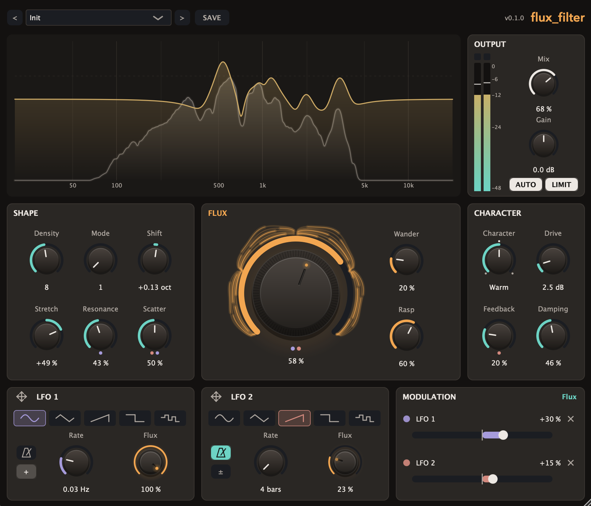

# flux_filter

flux_filter is an experimental formant filter: a field of up to
16 resonant cells, grouped into formants, that shapes any sound into vowels, throats and growls.
The cells drift, feed on the input, ring into each other, and are born and die. 
**Flux** sets how alive the field is, from a still formant filter to an unstable organism.



Formats: **VST3** (macOS, Windows, Linux), **AU** (macOS), **LV2** (Linux) and a **standalone app**
on every platform.

## Download and install

**macOS, one line in Terminal** (downloads the latest release and installs the VST3, the AU and the
app; nothing to unblock):

```bash
curl -fsSL https://raw.githubusercontent.com/tilohk/flux_filter/main/packaging/install-macos.sh | bash
```

Then rescan plug-ins in your DAW. In Ableton Live: **Settings → Plug-Ins**, hold **Option (⌥)** and
click **Rescan**.

**Or download the zip** for your system from the [latest release](https://github.com/tilohk/flux_filter/releases/latest).
Each zip contains `INSTALL.txt` with the exact steps; the macOS zip also contains `install-macos.sh`
(run it with `bash install-macos.sh` in Terminal). By hand:

| System  | Copy | To |
|---|---|---|
| macOS   | `flux_filter.vst3` / `flux_filter.component` | `~/Library/Audio/Plug-Ins/VST3/` / `~/Library/Audio/Plug-Ins/Components/` |
| Windows | `flux_filter.vst3` | `C:\Program Files\Common Files\VST3\` |
| Linux   | `flux_filter.vst3` / `flux_filter.lv2` | `~/.vst3/` / `~/.lv2/` |

You will find it as **flux_filter** by **Tilo Hauk** (category: filter).

`~/Library` is the Library folder inside your home folder, not the system-wide `/Library`. The macOS
build is not notarised by Apple: after copying by hand, run this once, otherwise macOS blocks the
plug-in and your DAW may hang while scanning:

```bash
xattr -dr com.apple.quarantine ~/Library/Audio/Plug-Ins/VST3/flux_filter.vst3 ~/Library/Audio/Plug-Ins/Components/flux_filter.component
```

**Requirements:** macOS 10.13 or later (Apple silicon and Intel), Windows 10 or later (64-bit),
Linux x86_64 with ALSA or JACK for the standalone app.

## Controls

**Shape:** what the throat looks like.
- **Density:** the number of cells (1–16). More cells form more formants (up to five).
- **Mode:** the throat shape, 1–18. Nine shapes (a, e, i, o, u, nasal, growl, schwa, whisper) and a
  halfway point between each pair; the ring wraps around.
- **Shift:** moves every formant up or down (±2 octaves), keeping the shape.
- **Stretch:** spacing between the formants, squeezed (−) or pulled apart (+).
- **Resonance:** from wide and breathy to narrow and singing.
- **Scatter:** 0 keeps the cells on their formants; higher values let them leave the structure and
  sit at free, uneven positions.

**Flux:** how alive the field is. Turning it up speeds up the drift, shortens the cells' lives and
couples them more strongly, so the field moves from calm to chaotic. The animated field around the
knob shows how much energy is going in.
- **Wander:** how far the chaos roams.
- **Rasp:** throat roughness, jitter and growl.

**Character:**
- **Character:** Clean, Warm or Broken saturation inside the cells.
- **Drive:** input gain into the field (0–24 dB).
- **Feedback** and **Damping:** a feedback loop around the field, with a damping filter; high
  feedback makes it ring and sustain.

**Output:** **Mix** (dry/wet, 50 % by default), **Gain**, **AUTO** (automatic gain compensation)
and **LIMIT** (output limiter).

**LFOs and modulation:** two LFOs (sine, triangle, saw, square, random), free-running or synced to
the host tempo (metronome button), bipolar or unipolar (± button).
- **Drag** an LFO by its move handle onto any knob to connect it. A dot in the LFO's colour under the
  knob shows the connection, and the knob's value arc moves with the modulation.
- Click a knob to show its connections in the **Modulation** panel: set the depth with the bar,
  switch a connection on or off with its dot, remove it with ×.
- **Flux (LFO):** how much of the LFO the living cells absorb. At 0 the LFO moves the knob directly;
  turned up, its movement is passed through the cells, which take it on each in their own time.

All parameters, including the connections, are automatable and saved with your project.

**Presets:** 14 factory presets in the preset menu at the top; **SAVE** stores your own.

## Build from source

You need CMake 3.22 or later and a C++20 compiler (Xcode 14+, Visual Studio 2022, or GCC 11+/Clang 14+).
JUCE 8 is downloaded automatically during configuration.

```bash
cmake -S . -B build -DCMAKE_BUILD_TYPE=Release
```

```bash
cmake --build build --config Release --target FluxFilter_All
```

The plug-ins end up in `build/FluxFilter_artefacts/Release/` and are also copied into your user
plug-in folders (turn this off with `-DFLUX_COPY_PLUGIN=OFF`). On macOS, add
`"-DCMAKE_OSX_ARCHITECTURES=arm64;x86_64"` for a universal binary.

Options:
- `-DFLUX_JUCE_DIR=/path/to/JUCE` (or the `JUCE_DIR` environment variable) uses a local JUCE checkout
  instead of downloading it.
- `-DFLUX_COPY_PLUGIN=OFF` skips copying into the system plug-in folders (required on Windows without
  admin rights).

**Linux packages** (Debian/Ubuntu):

```bash
sudo apt install build-essential cmake ninja-build libasound2-dev libjack-jackd2-dev ladspa-sdk libfreetype-dev libfontconfig1-dev libx11-dev libxcomposite-dev libxcursor-dev libxext-dev libxinerama-dev libxrandr-dev libxrender-dev libglu1-mesa-dev mesa-common-dev
```

### Tests

```bash
cmake --build build --config Release --target FluxFieldTest FluxModTest FluxPresetCheck
```

```bash
ctest --test-dir build -C Release --output-on-failure
```

- `FluxFieldTest`, `FluxModTest`: offline DSP tests of the field and the modulation (no JUCE).
- `FluxPresetCheck`: runs every factory preset through the real plug-in (finite, limited, not silent,
  not too loud). It builds JUCE a second time, so it is only built on request.
- `FluxBenchmark`: CPU cost per block.

### Releases

The version lives in one place: `project(FluxFilter VERSION …)` in `CMakeLists.txt`. GitHub Actions
builds and tests every push on macOS, Windows and Linux. Pushing a tag `vX.Y.Z` also creates a draft
GitHub release with the zipped builds and the matching section of [CHANGELOG.md](CHANGELOG.md) as notes.

## Documentation

- [CHANGELOG.md](CHANGELOG.md): what changed in each version.
- [docs/CONCEPT_V2.md](docs/CONCEPT_V2.md): the design of the current engine (formant field, life,
  Flux macro) and the decisions behind it.
- [docs/CONCEPT.md](docs/CONCEPT.md): the original v1 concept (a log bank moved by a travelling wave), kept for history.

## License

flux_filter is free software: you can redistribute it and/or modify it under the terms of the
[GNU Affero General Public License v3.0](LICENSE) as published by the Free Software Foundation.
It is distributed in the hope that it will be useful, but without any warranty; see the license for details.

Copyright © 2026 Tilo Hauk.

Built with [JUCE](https://juce.com), used under its AGPLv3 license. VST is a trademark of Steinberg
Media Technologies GmbH.
